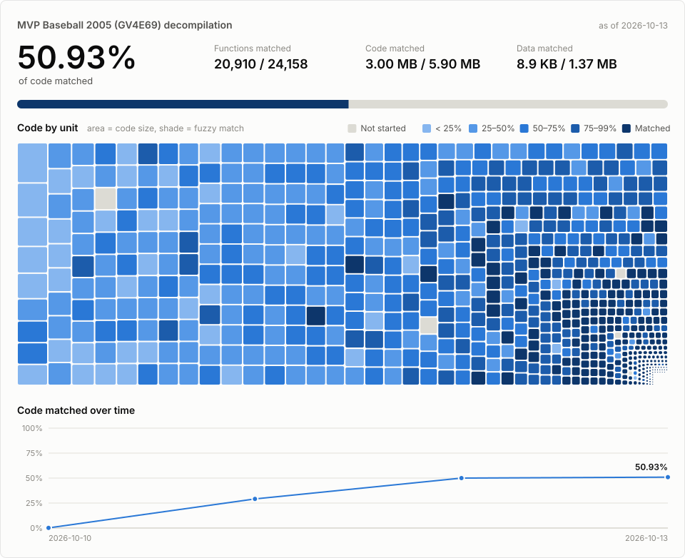

# MVP Baseball 2005 (GameCube, GV4E69) — Matching Decompilation Kit

Personal, private project. Goal: a C/C++ source tree that compiles back into a
byte-identical copy of the original `main.dol`, then later a native/WASM port
for personal play behind authenticated access.

## Progress



Each block in the treemap is one unit, sized by its code and shaded by objdiff's
fuzzy match percent (gray = not started, darkest blue = fully matched). Blocks
split as units are carved out of the auto-generated ones. The daily numbers
behind the line chart are in [`docs/progress/history.csv`](docs/progress/history.csv).

The card updates itself. A scheduled task on the owner's PC runs
`tools/progress_bot.py` every 2 minutes. When `main` has changed, it builds
`main` in a private worktree (`build/_progress/wt`), redraws the card if the
numbers moved, runs `tools/verify/verify.py`, and pushes a
`docs: update progress card` commit. Nothing needs doing by hand. Its log is
`build/_progress/bot.log`.

```sh
python tools/progress_bot.py --install     # register the task (done once)
python tools/progress_bot.py --uninstall   # remove it
python tools/progress_bot.py --force       # run once now
```

**[Live fleet dashboard](https://github.com/ptitty12/decompile_mvp_04/tree/dashboard)**:
matching speed (verified on `main` and claimed by workers, per hour), the
near-miss share, each worker's activity, the merge backlog and the functions
closest to matching. `tools/fleet_dashboard.py --publish` builds it from git
history alone (no build, no model calls). A second scheduled task runs it every
minute and replaces the one commit on the `dashboard` branch, so `main` gets
no extra commits. `--watch` shows the same numbers live in a terminal.

## What's in this kit

| File | Purpose | When you use it |
|---|---|---|
| `README.md` | This file. Plan, your manual steps, decisions. | Now |
| `CLAUDE.md` | Standing rules Claude Code reads every session. Copy to repo root. | Always present |
| `prompts/00_KICKOFF.md` | Paste into Claude Code to run Phase 0 (recon) + Phase 1 (scaffold). | Day 1 |
| `prompts/10_WORKER.md` | Paste to start a function-matching session (Phase 2+). | Daily grind |
| `prompts/20_AUDIT.md` | Periodic audit pass for cheating, drift, regressions. | Weekly |
| `docs/PHASES.md` | Phase plan with hard exit criteria. | Reference |
| `docs/RECON_CHECKLIST.md` | Questions Phase 0 must answer before any code. | Phase 0 |
| `.claude/settings.json` | Permission rules protecting the verifier and game files. | Copy to repo |
| `templates/PROGRESS.md`, `templates/DECISIONS.md` | Logs the agent maintains. | Copy to repo |

## Things only you can do (the agent should never touch these)

1. **Own a GameCube copy** of MVP Baseball 2005 and dump it yourself
   (Wii + CleanRip is the usual path). Keep the dump outside git.
2. **Record the dump's SHA-1** and compare it with the redump.org entry for your
   region, so you know your dump is clean.
3. **Pick a host.** Recommended: Linux or WSL2 (Ubuntu). REA's Ghidra support on
   Windows hosts is experimental; decomp-toolkit, objdiff, and the CodeWarrior
   compilers (via `wibo`) all run well on Linux. A Linux VM on the Unraid box
   works too.
4. **Install prerequisites:** git, Python 3, ninja, Ghidra + a JDK, Node 22.19+/24.11+,
   Claude Code, and REA (`npx rea-agents setup`). Phase 0 will tell you what's missing.
5. **Create a PRIVATE GitHub repo.** Never public. Never commit game files.
6. **Approve the compiler decision** at the end of Phase 0 (see below).

## The one decision that can change everything

decomp-toolkit assumes the game was built with **Metrowerks CodeWarrior**, which
most GameCube games were. EA titles of that era sometimes used **SN Systems ProDG**
(a GCC-based toolchain) instead. Phase 0 exists mainly to answer this:

- **CodeWarrior** → standard dtk-template path. Best case.
- **ProDG/GCC** → still possible, but byte matching needs the right old GCC
  build and dtk's automation helps less. Expect a slower project; decide then
  whether to continue matching or switch to "functionally equivalent" mode.

Phase 0 stops and reports before any scaffolding so you can make this call.

## How to run it

1. Make an empty private repo, copy `CLAUDE.md`, `.claude/`, `templates/*` into it.
2. Put your disc dump where Phase 0 asks (it'll be `orig/<GAME_ID>/`, gitignored).
3. Open Claude Code in the repo, paste `prompts/00_KICKOFF.md`.
4. Read the Phase 0 report. Approve or redirect.
5. After Phase 1 passes its exit criteria, run `prompts/10_WORKER.md` sessions.
   One agent first. Scale to 2–4 parallel agents on separate branches only after
   a week of clean single-agent results.
6. Every few days, run `prompts/20_AUDIT.md`.

## Lessons baked in (from people who finished one of these)

- **A machine-checkable PASS/FAIL beats any reviewer.** Readable-but-wrong code
  is the default failure mode without it.
- **Agents cheat when rules leave room:** inline asm, raw byte embedding,
  editing the verifier. The rules forbid these and `settings.json` blocks edits
  to the verifier; CI also checks its hash.
- **Instructions decay.** The worker prompt forces a re-read of `CLAUDE.md` every
  N functions.
- **Compact early.** Decomp context is mostly disposable. Keep sessions short and
  per-unit.
- **Throw bad code away.** Regenerating is cheaper than salvaging.
- **Correctness over throughput.** Scale agents only after quality is proven.

## Rough expectations

- Phase 0–1 (recon + building an identical binary from split asm): days.
- Phase 2 (matching): weeks to months, depends on code size, compiler, and spend.
- Phase 3 (port): only after the core game loop is matched or near-matched.

## Note on `.claude/settings.json`

The deny rules assume the verifier lives in `tools/verify/` and CI in
`.github/workflows/`. After Phase 1, update the paths to wherever the scaffold
actually puts the verification scripts. Edit this file yourself; the agent is
blocked from editing `.claude/`. Check the Claude Code permissions docs if a
rule doesn't behave as expected, since the pattern syntax can change between versions.
